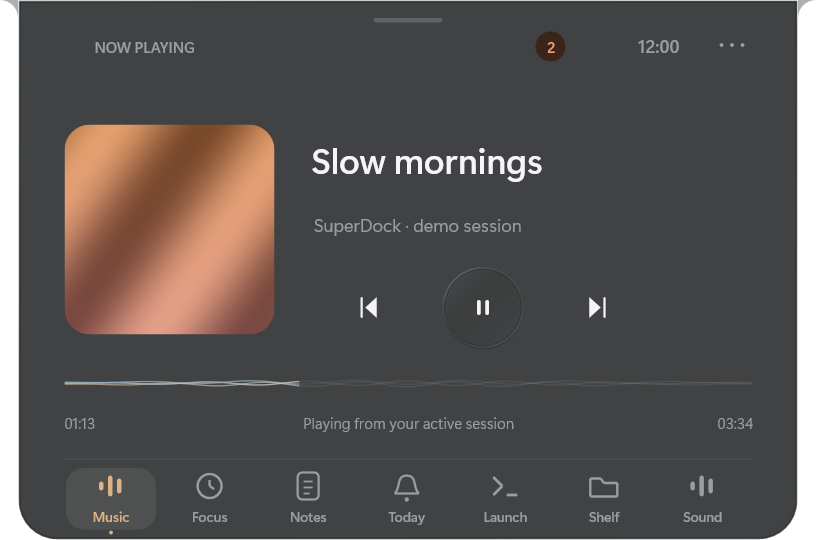
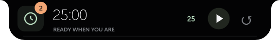
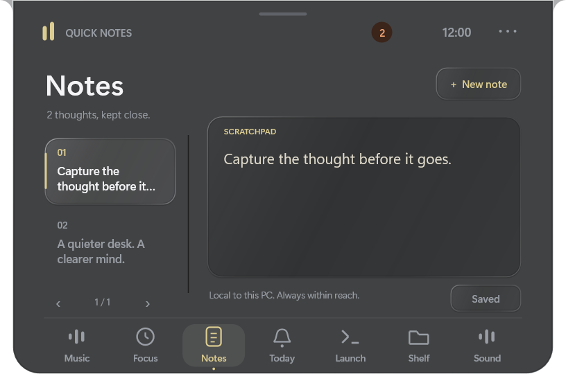
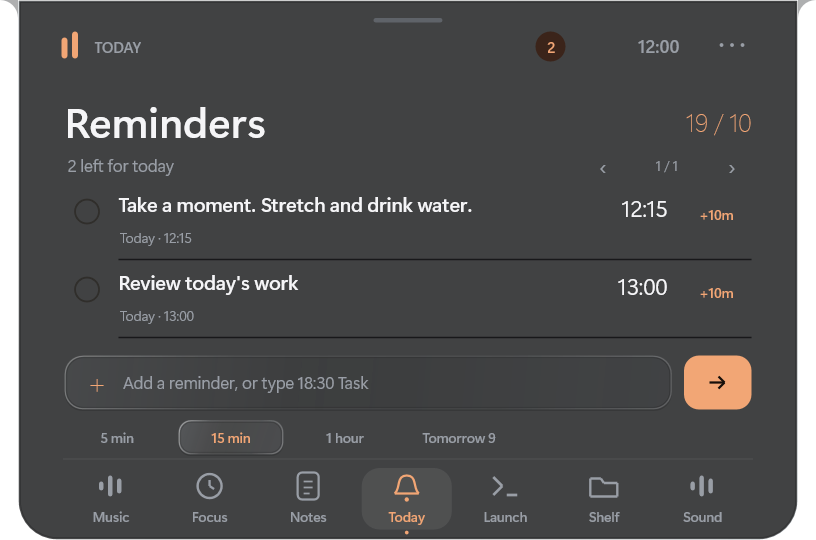



<h1 align="center">SuperDock</h1>

A useful little notch for Windows.

<b>Windows 11 · x64 · Free early access · Private source</b>

Music, focus, quick notes, reminders, sound, and the files you're about to use —
one glance away, in a notch you can move.

## Download

[Download SuperDock v1.0.2](https://github.com/DEBAPALLAB/SuperDock/releases/tag/v1.0.2)
for Windows 11 x64.

- [Windows installer](https://github.com/DEBAPALLAB/SuperDock/releases/download/v1.0.2/SuperDock-1.0.2-windows-x64-setup.exe)
- [Portable ZIP](https://github.com/DEBAPALLAB/SuperDock/releases/download/v1.0.2/SuperDock-1.0.2-windows-x64-portable.zip)

Choose the installer for Start menu/uninstall integration, or extract the
portable ZIP and run **SuperDock.exe**. No compiler, Python, .NET, or account is
needed. Startup is optional and off by default.

This repository contains downloads, screenshots, documentation, and feedback.
The application source is private.

## Small when you want it. Useful when you need it.

- **AOD:** a small capsule with one-line widgets, playback controls, and reminder counts.
- **Glass:** GPU desktop refraction, soft frosting, RGB edge dispersion, and smooth transitions.
- **Music:** artwork, playback controls, seeking, album-colored progress waves.
- **Focus:** a quiet countdown dial with focus, deep-work, and break sessions.
- **Notes:** a scratchpad and saved-note rail, local to your PC.
- **Reminders:** quick entry, daily counts, snooze, and completion from the notch.
- **Sound:** volume and mute without hunting for another panel.
- **Launch:** terminal, files, browser, and Settings; choose your workspace folder.
- **Shelf:** keep up to three dropped files close, then drag them where needed.

Hover or press **Ctrl+Alt+Space** to open. Scroll over the collapsed notch to
switch widgets. Drag its top strip to move it, including between monitors.

**Ctrl+Alt+N:** quick note. **Ctrl+Alt+R:** reminder.
Right-click for startup, terminal folder, help, downloads, and Exit.

## Privacy and release status

No account or app telemetry. Notes and reminders stay on your PC. See
[Privacy](PRIVACY.md).

Enabled liquid glass hides SuperDock from screen recordings to prevent feedback.
Toggle Liquid glass off in the right-click menu to record the dock.

Reminders fire while SuperDock is running and catch up when it starts again.
Music controls depend on the player exposing a Windows media session.
Complete screen-reader/IME support, broader mixed-DPI hardware validation, and an
automatic updater are still in progress.

This is an early, unsigned release. Windows may show an unrecognized-publisher
warning. Clean-machine installation and broader hardware testing are still
pending. Keep Windows security features enabled.

Screenshots use synthetic demonstration content rendered by the app; they do
not contain personal notes or listening history and are not FPS measurements.

## Help make it better

[Report a bug or suggest a useful action](https://github.com/DEBAPALLAB/SuperDock/issues/new/choose).
Include your SuperDock version, Windows version, monitor scaling, media app if
relevant, and the steps that failed. Review screenshots for private information.

Want to share it? Link to the
[official releases](https://github.com/DEBAPALLAB/SuperDock/releases) and use an
unmodified official package.

